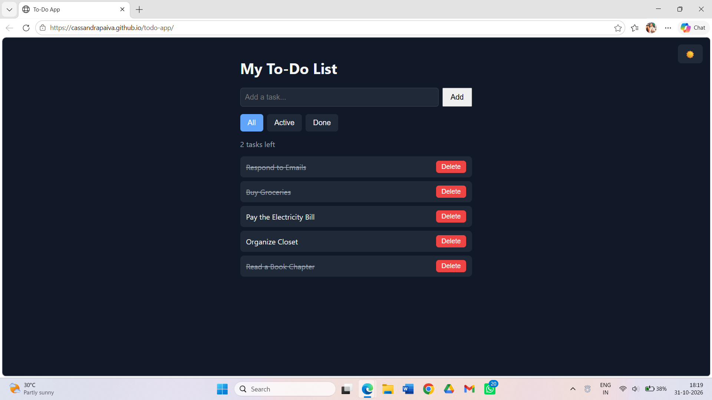

# To-Do App

A simple to-do list app built with HTML, CSS and JavaScript.

**Live demo:** https://yourusername.github.io/todo-app

## Features
- Add, complete and delete tasks
- Filter by All / Active / Done
- Counter showing tasks left
- Tasks saved in the browser with localStorage
- Dark mode that remembers your choice

## Built with
- HTML
- CSS (variables for theming)
- JavaScript (DOM manipulation, localStorage)

## What I learned
- Updating an array of data and re-rendering the page from it
- Saving and loading data with localStorage and JSON
- Using CSS variables to switch themes
